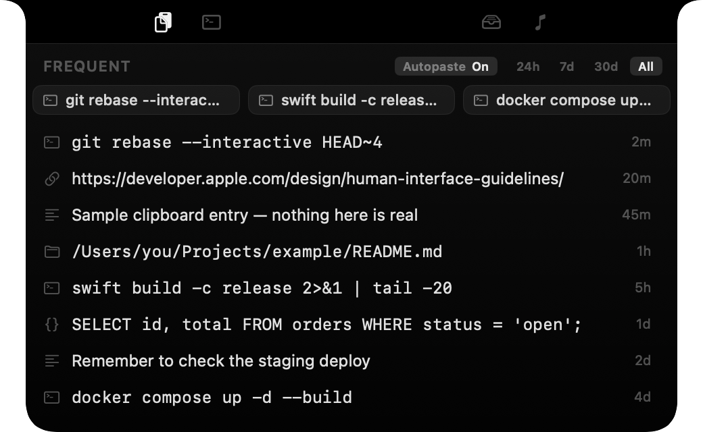
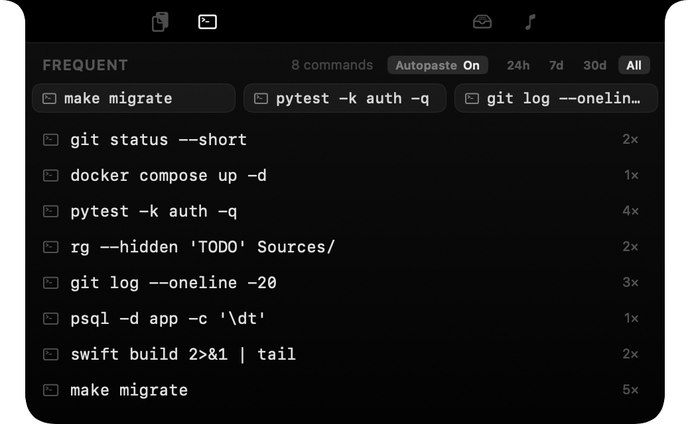
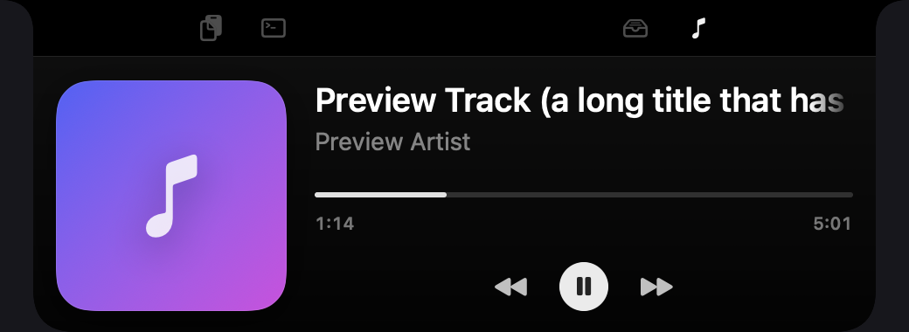

# Dev Island

A personal dev toolbox that lives in the MacBook notch. Music, clipboard history,
terminal history and a file shelf in one panel that drops out of the cutout on
hover, plus a now-playing chin and a paste acknowledgement that appear while the
island is closed.



Source-only: there are no release binaries. Build it with `./build.sh` (below).

## Requirements

- **A MacBook with a notch.** The island anchors to the physical cutout; on a Mac
  without one it says so and quits.
- **macOS 26 or later.**
- **Xcode command line tools** (`swiftc`, `clang`). No package manager, no SPM, no
  third-party dependencies — the one external component is vendored as source.

## Build

```zsh
git clone <this repo> DevIsland
cd DevIsland
./build.sh
```

That compiles the app and the vendored media helper, signs both, moves the bundle
to `~/Applications/Dev Island.app`, registers it with LaunchServices, and leaves
`DevIsland.app` in the repo as a symlink to it. After that, **⌘Space → "Dev
Island"** launches it.

### Signing, and why it matters here

macOS keys Accessibility and Automation grants to the code-signing identity. An
ad-hoc signature produces a new requirement on every build, so the grants drop and
auto-paste stops working after each rebuild — silently, which looks like a bug.

`build.sh` resolves an identity in this order:

1. `ISLAND_SIGN_IDENTITY`, if set
2. **`Dev Island Local Signing`** from your keychain, if present
3. exactly one `Apple Development` identity, if you have one
4. otherwise it fails loudly rather than shipping something that looks signed

The easy path is (2): create a self-signed Code Signing certificate with that name
(Keychain Access → Certificate Assistant → Create a Certificate → Code Signing, or
the `openssl` recipe in `PLAN.md` §11). Then grants survive every rebuild.

For a quick look without the certificate:

```zsh
ISLAND_SIGN_IDENTITY=- ISLAND_NO_INSTALL=1 ./build.sh
```

Ad-hoc works, but expect to re-grant Accessibility after each rebuild.

Other build switches: `ISLAND_NO_INSTALL=1` skips the install step,
`ISLAND_INSTALL_DIR` installs somewhere other than `~/Applications`.

## First run

Two permission prompts, both expected:

| Prompt | Why |
| --- | --- |
| **Accessibility** | Posting the synthetic ⌘V for auto-paste. Asked once at launch; also reachable at Privacy & Security → Accessibility if you dismiss it. Without it, clicks still copy — the app says so rather than failing silently |
| **Automation → Spotify** | Reading the current track and controlling playback, on first music-panel open |

The terminal panel has two prerequisites in `~/.zshrc`, because zsh only writes
history in a useful way with them:

```zsh
setopt INC_APPEND_HISTORY   # write each command as it runs, not on shell exit
setopt EXTENDED_HISTORY     # timestamp entries, needed by the 24h/7d/30d windows
```

Without the first the panel shows stale history and says so; without the second,
commands have no timestamps and only appear under "All".

## Using it

- **Open** by hovering the notch; it closes shortly after the pointer leaves.
- **Open from the keyboard** with `⌃⌥↓`, which toggles the island open or closed.
- **Switch panels** with the icons either side of the cutout, `⌥1`–`⌥4`, or
  `⌃⌥←` / `⌃⌥→` to cycle (also `⌥Tab` / `⌥⇧Tab`). The panel shortcuts only exist
  while the island is open; the open key is always armed.
- **Click a row** to paste into whatever had focus, or copy. `⌥`-click always
  copies. The **Autopaste** pill toggles the default and is remembered; either way
  a short toast says what happened — `Auto-pasted` or `Copied to clipboard`.
- **Time windows** — `24h / 7d / 30d / All` on both history panels. A filter, not
  retention: choosing 24h hides rows and deletes nothing.
- **Drag a file at the closed notch** to put it on the shelf; drag it out again
  to move it where it belongs. The shelf holds references, so removing a row never
  touches the real file.
- **Quit** from the capsule in the menu bar. There is deliberately no login item.

| Panel | Size | What it holds |
| --- | --- | --- |
| Clipboard | 520 × 320 | History with frecency chips, ages, kinds |
| Terminal | 520 × 320 | `~/.zsh_history`, trivia filtered |
| Shelf | 440 × 102–260 | File references; height follows the count |
| Music | 520 × 190 | Artwork, scrub, transport |





The screenshots use sample data.

### Media

Anything the system reports as "now playing" — Spotify, Apple Music, a browser
playing YouTube, VLC — with title, artist, position and, where the player publishes
one, the thumbnail. Spotify takes precedence when it is actually playing; everything
else comes through the helper.

That helper exists because macOS 15.4 stopped returning now-playing information to
ordinary apps: reading requires an entitled process, so the app runs
[mediaremote-adapter](https://github.com/ungive/mediaremote-adapter) (BSD-3, vendored
as source) inside `/usr/bin/perl`. Commands still go through the direct API — only
reading is gated.

## Troubleshooting

| Symptom | Likely cause |
| --- | --- |
| Auto-paste only copies | Accessibility grant missing for this build. Re-grant after an ad-hoc rebuild, or use a stable identity |
| Terminal panel is empty or stale | The two `setopt` lines above, then open a **new** terminal window |
| Music panel empty, Spotify is playing | Automation permission for Spotify |
| Nothing at all | Run it from Terminal to see stderr: `./DevIsland.app/Contents/MacOS/DevIsland` |
| Two media helpers / odd duplicates | Relaunch; the app sweeps a stale helper at startup by pid file |

Inspection switches, if you want to see what it is doing: `ISLAND_MEDIA_PROBE=1`
(now-playing updates), `ISLAND_DRAG_PROBE=1` (drag events), `ISLAND_DATA_DIR=<path>`
(run against a throwaway store), `ISLAND_HISTORY=<path>` (a fixture history file),
`ISLAND_RENDER=<png>` (headless preview). `PLAN.md` §12 has the detail.

## Uninstall

Quit from the menu bar, delete `~/Applications/Dev Island.app`, and remove
`~/Library/Application Support/Dev Island/` (clipboard history, shelf, ignore rules).
The two `setopt` lines in `~/.zshrc` are harmless but can go too.

## Repo layout

| Path | What |
| --- | --- |
| `Sources/` | The app. `PLAN.md` §14 maps each file to its job |
| `vendor/mediaremote-adapter/` | BSD-3 source for the media helper, compiled by `build.sh` |
| `build.sh` | Build, sign, install, register |
| `docs/` | Screenshots |
| `PLAN.md` | The design document: what was built, what was rejected and why, measured facts, risks |
| `MIGRATION.md` | Notes from the bundle-ID rename, kept for the record |

## Licence

MIT — see `LICENSE`.

The vendored media adapter is BSD-3-Clause; its notice ships in the app bundle as
`MediaRemoteAdapter-LICENSE.txt` and its source is in `vendor/`.

Geometry and corner radii follow
[BoringNotch](https://github.com/TheBoredTeam/boring.notch) (GPL-3). That is
approach, not code: the notch shape constants and which system APIs to use. No
code is shared with it — see `PLAN.md` §5 for where the line is drawn.
